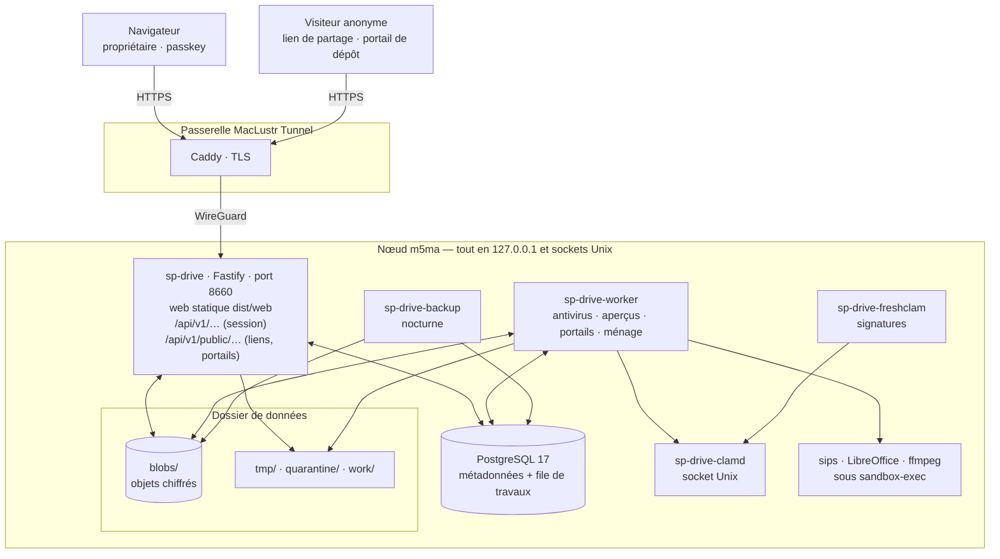
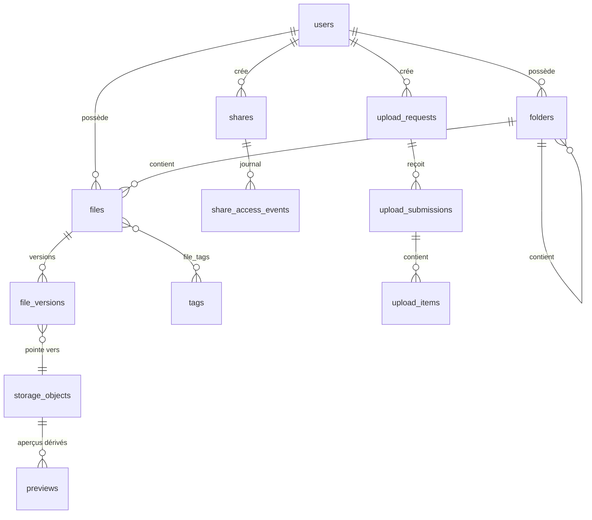
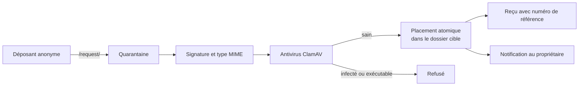

<div align="center">

# 🗄️ SP Drive

**Stockage documentaire privé auto-hébergé — explorateur de fichiers chiffrés, aperçus, liens de partage et portails de dépôt, avec connexion par passkey uniquement.**

[](https://drive.spboucher.ai)


[](https://git.spboucher.ai/sp-drive/commits)
[](https://git.spboucher.ai/sp-drive/commits)
[](https://git.spboucher.ai/sp-drive/insights)
[](https://git.spboucher.ai/sp-drive)
[](https://git.spboucher.ai/sp-drive/insights)
[](https://git.spboucher.ai/sp-drive)
[](https://git.spboucher.ai/sp-drive/branches)
[](https://git.spboucher.ai/sp-drive/tags)
[](https://git.spboucher.ai/sp-drive)


</div>

---

## Sommaire

- [Présentation](#-présentation)
- [Fonctionnalités](#-fonctionnalités)
- [Architecture](#-architecture)
- [Pile technique](#-pile-technique)
- [Arborescence](#-arborescence)
- [Démarrage rapide](#-démarrage-rapide)
- [Configuration](#-configuration)
- [API](#-api)
- [CLI d'exploitation](#-cli-dexploitation)
- [Modèle de données](#-modèle-de-données)
- [Stockage et chiffrement](#-stockage-et-chiffrement)
- [Aperçus](#-aperçus)
- [Liens de partage et portails de dépôt](#-liens-de-partage-et-portails-de-dépôt)
- [Tests et qualité](#-tests-et-qualité)
- [Déploiement (MacLustr, `mld`)](#-déploiement-maclustr-mld)
- [Sécurité](#-sécurité)
- [État et feuille de route](#-état-et-feuille-de-route)
- [Documentation](#-documentation)
- [Auteur et licence](#-auteur-et-licence)

---

## 🎯 Présentation

SP Drive est un stockage documentaire auto-hébergé pour **https://drive.spboucher.ai**, sur le cluster MacLustr. Il
offre un explorateur de fichiers complet dans le navigateur (bureau et téléphone), des aperçus pour les formats
courants, des liens de partage contrôlés et des **portails de dépôt** par lesquels un tiers envoie des fichiers sans
jamais rien pouvoir lire.

Principes du projet :

- **Du vrai code seulement** : chaque fichier, permission et événement est persisté ; pas de maquette, pas de faux
  lien, pas de bouton inerte.
- **Chiffrement par l'application** : chaque objet a sa propre clé, enveloppée par une clé maîtresse tenue hors du
  dépôt et hors des sauvegardes.
- **Aucune URL de stockage exposée** : chaque lecture passe par l'API, qui contrôle l'autorisation puis déchiffre en flux.
- **Cloisonnement strict** : toute route qui prend un identifiant le filtre par propriétaire ; un identifiant étranger
  répond 404.
- **Rien de sensible dans les journaux** : ni contenu de document, ni jeton de lien, ni mot de passe ; les URL
  publiques sont expurgées du journal des requêtes.

## ✨ Fonctionnalités

| Domaine | Ce qui est construit |
|---|---|
| **Comptes** | invitation à usage unique, passkeys (plusieurs, renommage, retrait sauf la dernière), sessions par appareil avec révocation, rotation quotidienne du jeton, réauthentification pour les opérations sensibles, codes de récupération, TOTP facultatif, administration (utilisateurs, quotas, invitations, état du système), journal d'activité |
| **Explorateur** | dossiers imbriqués, création, renommage, déplacement, copie, corbeille, restauration, suppression définitive ; téléversement multiple, par dossier, résumable, avec pause, reprise, annulation et SHA-256 ; collisions explicites (échec, renommer, nouvelle version) ; téléchargement direct avec reprise et ZIP ; versions ; quotas ; tags ; favoris ; récents ; recherche avec filtres ; doublons par compte ; grille et liste ; clavier ; glisser-déposer |
| **Aperçus** | PDF (pages, zoom, recherche), images, HEIC, SVG inerte, vidéo, audio, texte, Markdown assaini, CSV, JSON, classeurs XLSX, inventaire ZIP/TAR ; message clair pour le reste et pour les échecs |
| **Liens de partage** | fichier ou dossier, lecture seule ou téléchargement, mot de passe, expiration, plafonds de consultations et de téléchargements, usage unique, rotation, révocation immédiate, journal d'accès |
| **Portails de dépôt** | création illimitée, formulaire configurable, consentement, limites (taille, nombre, volume, fréquence, types), mot de passe, expiration, pause, rotation, révocation, suppression ; quarantaine → signature → antivirus → placement atomique ; reçu avec numéro de référence ; journal par dépôt ; notification au propriétaire |
| **Stockage** | objets et aperçus chiffrés (AES-256-GCM par blocs, clé par objet), lecture par plage, détection d'altération, ramasse-miettes |
| **Interface** | français et anglais, clair et sombre, bureau et téléphone, palette de commandes (<kbd>⌘</kbd><kbd>K</kbd>), PWA installable (manifeste, icônes, service worker qui ne met en cache ni l'API ni les documents) |
| **Exploitation** | manifeste `mld`, préparation du nœud, antivirus et mises à jour de signatures, sauvegarde nocturne chiffrée, test de restauration, CLI |

## 🏗 Architecture



Deux processus applicatifs seulement — `sp-drive` (API + web) et `sp-drive-worker` — plus les services de soutien
(ClamAV, sauvegarde). Écarts motivés par rapport à une architecture « classique » ([architecture.md](docs/architecture.md)) :

| Cible habituelle | Choix | Raison |
|---|---|---|
| Next.js | API Fastify + SPA Vite/React servie par l'API | un port, un processus, une origine ; contrôle direct des flux HTTP (téléversements résumables, flux chiffré avec `Range`) |
| Redis | file de travaux PostgreSQL (`jobs`, `FOR UPDATE SKIP LOCKED`) | les travaux sont transactionnels avec les métadonnées |
| MinIO / S3 | interface `BlobStore` + pilote système de fichiers | un seul nœud ; le chiffrement et l'adressage sont au-dessus du pilote |
| URL signées | aucune URL de stockage exposée | chaque lecture passe par l'API |
| Docker Compose | PM2 + Homebrew via `mld` | convention du cluster |
| Microservices | deux processus, modules séparés dans le code | pas de microservices superflus |

## 🧰 Pile technique

| Rôle | Technologie | Version (lockfile) |
|---|---|---|
| Langage | TypeScript | 7.0.2 |
| Exécution | Node.js | ≥ 24 (`engines`) |
| API | Fastify (`@fastify/cookie` 11.1.5, `@fastify/rate-limit` 11.2.2, `@fastify/static` 10.1.10) | 5.12.8 |
| Base de données | PostgreSQL, pilote `postgres` | 17 / 4.1.0 |
| Validation | zod | 4.6.7 |
| Passkeys | `@simplewebauthn/server` / `@simplewebauthn/browser` | 14.1.0 / 14.0.0 |
| Interface | React / React DOM | 19.3.1 |
| Outil de build web | Vite (`@vitejs/plugin-react` 6.3.0) | 8.3.7 |
| Styles | Tailwind CSS (`@tailwindcss/vite`) | 4.3.5 |
| Données côté client | TanStack Query | 5.107.1 |
| Routage côté client | wouter | 3.13.0 |
| Aperçu PDF | pdf.js (`pdfjs-dist`) | 6.5.438 |
| Markdown | marked + DOMPurify | 18.2.0 / 3.4.17 |
| Classeurs | exceljs | 4.4.0 |
| Détection de type | file-type | 22.3.0 |
| Archives | yauzl, yazl, tar-stream | — |
| Codes QR | qrcode | — |
| Antivirus | ClamAV (`clamd`, `freshclam`) | Homebrew |
| Conversions | `sips`, LibreOffice, ffmpeg, sous `sandbox-exec` | macOS / Homebrew |
| Bundle des services | esbuild | 0.28.2 |
| Tests | Vitest / Playwright | 5.1.0 / 1.65.0 |
| Gestionnaire de paquets | pnpm (espace de travail) | 11.1.2 |
| Gestionnaire de processus | PM2 | — |

## 🗂 Arborescence

```text
sp-drive/
├── packages/shared/            # règles de nommage et limites partagées (API, worker, web) — aucune E/S
├── services/api/
│   ├── src/
│   │   ├── main.ts, server.ts  # démarrage, Fastify, santé, en-têtes
│   │   ├── auth.ts             # passkeys, sessions, récupération, TOTP, comptes, administration
│   │   ├── tree.ts, files.ts   # dossiers, fichiers, corbeille, versions, tags, recherche, doublons
│   │   ├── uploads.ts          # téléversements résumables
│   │   ├── content.ts          # lecture, Range, ZIP
│   │   ├── shares.ts           # liens de partage (propriétaire et pages publiques)
│   │   ├── requests.ts         # portails de dépôt
│   │   ├── blob.ts, crypto.ts  # stockage et chiffrement
│   │   ├── jobs.ts, worker.ts, worker-main.ts   # file de travaux PostgreSQL et worker
│   │   ├── tools.ts, tools-sheet.ts, sheet-child.ts   # convertisseurs et lecture des classeurs
│   │   ├── cli.ts              # commandes d'exploitation
│   │   ├── config.ts, db.ts
│   │   └── migrations/001_init.ts   # 23 tables, avec up et down
│   └── test/                   # 5 suites d'intégration (PostgreSQL réel, clamd réel)
├── apps/web/
│   └── src/
│       ├── explorer/           # explorateur, détails, doublons, panneau de téléversement
│       ├── preview/            # visionneuses PDF, image, média, classeur, archive, texte, Markdown
│       ├── sharing/            # dialogues de partage et de portail
│       ├── public-pages/       # pages publiques : lien de partage, portail de dépôt
│       ├── screens/            # connexion, invitation, récupération, réglages, administration, partages, demandes
│       ├── shell/              # coquille, palette de commandes, notifications
│       ├── i18n/               # 6 dictionnaires français / anglais
│       └── sw.ts, upload-engine.ts, api.ts, …
├── tests/e2e/                  # 7 suites Playwright + jeux de fichiers (dont fichiers hostiles)
├── tests/shots/                # captures d'écran
├── infra/                      # gabarits clamd / freshclam, gabarit du manifeste mld
├── scripts/                    # build, pile de développement, préparation du nœud, sauvegarde, test de restauration, fumée de production
├── docs/                       # brief, architecture, plan, avancement, modèle de menaces, runbook
└── CLAUDE.md, package.json, pnpm-workspace.yaml, tsconfig.base.json, vitest.config.ts
```

## 🚀 Démarrage rapide

Prérequis : Node.js ≥ 24, pnpm, PostgreSQL 17 (Homebrew). ClamAV et LibreOffice sont nécessaires pour l'antivirus et
les aperçus bureautiques.

```bash
pnpm install
pnpm typecheck          # shared, api, web, service worker
pnpm test               # vitest : PostgreSQL réel (sp_drive_test), clamd réel si des signatures sont présentes
pnpm build              # dist/api.mjs, worker.mjs, cli.mjs, sheet-child.mjs, dist/web
scripts/dev-stack.sh    # API sur le port 8661 + web http://localhost:5183
scripts/dev-invite.sh <courriel> [--admin]     # lien d'invitation à usage unique pour la pile locale
pnpm e2e                # Playwright contre la pile de développement
```

| Commande | Rôle |
|---|---|
| `pnpm typecheck` | `tsc` sur `packages/shared`, `services/api`, `apps/web` et le service worker |
| `pnpm test` | suites Vitest |
| `pnpm build` | bundles esbuild des services, puis build Vite du web |
| `pnpm e2e` | Playwright (`tests/e2e/playwright.config.ts`) |
| `pnpm migrate` | applique les migrations (`services/api/src/cli.ts migrate`) |
| `scripts/dev-stack.sh [--reset]` | pile locale : API avec worker intégré + serveur Vite ; base `sp_drive_dev`, données sous `.dev/` |
| `scripts/node-setup.sh` | préparation unique du nœud (base, dossiers, clé maîtresse, antivirus, premières signatures) |
| `scripts/backup.sh` | sauvegarde : copie incrémentale des objets chiffrés + dump PostgreSQL chiffré |
| `scripts/restore-test.sh` | preuve de restauration dans une base temporaire, sans toucher la production |
| `scripts/prod-smoke.mts <url> <invitation>` | test de fumée contre une instance déployée, avec un compte jetable |

## ⚙️ Configuration

La configuration se fait par variables d'environnement (`services/api/src/config.ts`). En production elles sont dans
l'environnement PM2 du manifeste `mld`, pas dans un fichier `.env`.

| Variable | Rôle | Défaut |
|---|---|---|
| `SPD_ORIGIN` | origine publique exacte du site | obligatoire |
| `SPD_RP_ID` | identifiant de partie de confiance WebAuthn (nom d'hôte) | obligatoire |
| `DATABASE_URL` | connexion PostgreSQL | obligatoire |
| `PORT` | port d'écoute de l'API | `8660` |
| `HOST` | adresse d'écoute | `127.0.0.1` |
| `SPD_TRUST_PROXY` | adresses de mandataires de confiance (séparées par des virgules) | bouclage |
| `SPD_WEB_DIR` | dossier du web construit, servi par l'API | vide |
| `SPD_DATA_DIR` | dossier des données (`blobs/`, `tmp/`, `quarantine/`, `work/`) | `~/sp-drive-data` |
| `SPD_APP_DIR` | dossier du code (lisible par les convertisseurs en bac à sable) | dossier courant |
| `SPD_MASTER_KEY_FILE` | fichier de la clé maîtresse (32 octets, hors dépôt) | `~/.config/sp-drive/master.key` |
| `SPD_DEFAULT_QUOTA_GB` | quota d'un nouveau compte | `100` |
| `SPD_MAX_FILE_GB` | taille maximale d'un fichier | `50` |
| `SPD_CLAMD_SOCKET` | socket Unix de `clamd` ; vide = pas d'antivirus | vide |
| `SPD_AV_MODE` | `required` (les dépôts restent en quarantaine si l'antivirus manque) ou `optional` (développement et tests) | `required` |
| `SPD_SOFFICE` | chemin de l'exécutable LibreOffice | emplacement standard de l'application macOS |
| `SPD_OFFICE_MAX_MB` | taille maximale d'un document bureautique à convertir | `100` |
| `SPD_SHEET_MAX_MB` | taille maximale d'un classeur à lire | `30` |
| `SPD_CONVERT_TIMEOUT_S` | délai maximal d'une conversion | `90` |
| `SPD_INLINE_WORKER` | `on` : boucle de travaux dans le processus de l'API (développement, tests) | désactivé |
| `SPD_COMMIT` | identifiant de version injecté au build | commit git courant |
| `SPD_BACKUP_DIR` | dossier des sauvegardes (`scripts/backup.sh`) | `~/backups/sp-drive` |
| `SPD_BACKUP_REMOTE` | destination `hôte:chemin` d'une seconde copie par rsync | non définie |
| `SPD_E2E_BASE` | cible des tests de bout en bout | `http://localhost:5183` |

Limites partagées (`packages/shared`) : nom de 255 octets au plus, blocs de téléversement de 8 Mio envoyés par le
client, 16 Mio acceptés au maximum par l'API.

## 🔌 API

**92 routes** sous `/api/v1`, dont 12 publiques sous `/api/v1/public/` (liens de partage et portails de dépôt). Toute
requête modifiante exige l'en-tête `X-SPD-CSRF` et une origine identique ; il n'y a pas de CORS.

| Module | Routes | Contenu |
|---|---|---|
| `auth.ts` | 30 | authentification (10), compte (15), administration des utilisateurs et invitations (5) |
| `files.ts` | 27 | dossiers, fichiers, contenu, versions, ZIP, corbeille, recherche, tags, notifications |
| `uploads.ts` | 6 | téléversements résumables |
| `shares.ts` | 12 | liens de partage : 6 côté propriétaire, 6 publiques |
| `requests.ts` | 14 | portails de dépôt : 8 côté propriétaire, 6 publiques |
| `server.ts` | 3 | santé, état du système |

<details>
<summary><b>Authentification et compte — 30 routes</b></summary>

| Méthode | Route |
|---|---|
| GET | `/api/v1/auth/state` |
| POST | `/api/v1/auth/invite` |
| POST | `/api/v1/auth/register/options` |
| POST | `/api/v1/auth/register/verify` |
| POST | `/api/v1/auth/login/options` |
| POST | `/api/v1/auth/login/verify` |
| POST | `/api/v1/auth/logout` |
| POST | `/api/v1/auth/recovery` |
| POST | `/api/v1/auth/reauth/options` |
| POST | `/api/v1/auth/reauth/verify` |
| GET | `/api/v1/account/passkeys` |
| POST | `/api/v1/account/passkeys/options` |
| POST | `/api/v1/account/passkeys/verify` |
| PATCH | `/api/v1/account/passkeys/:id` |
| DELETE | `/api/v1/account/passkeys/:id` |
| GET | `/api/v1/account/sessions` |
| DELETE | `/api/v1/account/sessions/:id` |
| POST | `/api/v1/account/sessions/revoke-others` |
| GET | `/api/v1/account/security` |
| POST | `/api/v1/account/recovery-codes` |
| POST | `/api/v1/account/totp/setup` |
| POST | `/api/v1/account/totp/enable` |
| DELETE | `/api/v1/account/totp` |
| PATCH | `/api/v1/account` |
| GET | `/api/v1/account/activity` |
| GET | `/api/v1/admin/users` |
| PATCH | `/api/v1/admin/users/:id` |
| GET | `/api/v1/admin/invites` |
| POST | `/api/v1/admin/invites` |
| DELETE | `/api/v1/admin/invites/:id` |

</details>

<details>
<summary><b>Dossiers, fichiers, téléversements — 33 routes</b></summary>

| Méthode | Route |
|---|---|
| GET | `/api/v1/folders/:id` |
| GET | `/api/v1/folders/:id/children` |
| POST | `/api/v1/folders` |
| PATCH | `/api/v1/folders/:id` |
| GET | `/api/v1/files/:id` |
| PATCH | `/api/v1/files/:id` |
| GET | `/api/v1/files/:id/content` |
| GET | `/api/v1/files/:id/preview/:kind` |
| POST | `/api/v1/files/:id/versions/:versionId/restore` |
| DELETE | `/api/v1/files/:id/versions/:versionId` |
| GET | `/api/v1/zip` |
| POST | `/api/v1/move` |
| POST | `/api/v1/copy` |
| POST | `/api/v1/trash` |
| POST | `/api/v1/restore` |
| POST | `/api/v1/purge` |
| GET | `/api/v1/trash` |
| GET | `/api/v1/recent` |
| GET | `/api/v1/starred` |
| GET | `/api/v1/search` |
| GET | `/api/v1/duplicates` |
| GET | `/api/v1/tags` |
| POST | `/api/v1/tags` |
| PATCH | `/api/v1/tags/:id` |
| DELETE | `/api/v1/tags/:id` |
| GET | `/api/v1/notifications` |
| POST | `/api/v1/notifications/read` |
| POST | `/api/v1/uploads` |
| GET | `/api/v1/uploads/:id` |
| PATCH | `/api/v1/uploads/:id` |
| POST | `/api/v1/uploads/:id/complete` |
| PATCH | `/api/v1/uploads/:id/options` |
| DELETE | `/api/v1/uploads/:id` |

</details>

<details>
<summary><b>Liens de partage — 12 routes</b></summary>

| Méthode | Route |
|---|---|
| GET | `/api/v1/shares` |
| POST | `/api/v1/shares` |
| PATCH | `/api/v1/shares/:id` |
| DELETE | `/api/v1/shares/:id` |
| POST | `/api/v1/shares/:id/rotate` |
| GET | `/api/v1/shares/:id/events` |
| GET | `/api/v1/public/shares/:token` |
| POST | `/api/v1/public/shares/:token/open` |
| GET | `/api/v1/public/shares/:token/list` |
| GET | `/api/v1/public/shares/:token/files/:fileId/content` |
| GET | `/api/v1/public/shares/:token/files/:fileId/preview/:kind` |
| GET | `/api/v1/public/shares/:token/zip` |

</details>

<details>
<summary><b>Portails de dépôt — 14 routes</b></summary>

| Méthode | Route |
|---|---|
| GET | `/api/v1/requests` |
| POST | `/api/v1/requests` |
| GET | `/api/v1/requests/:id` |
| PATCH | `/api/v1/requests/:id` |
| DELETE | `/api/v1/requests/:id` |
| POST | `/api/v1/requests/:id/rotate` |
| GET | `/api/v1/requests/:id/submissions` |
| GET | `/api/v1/submissions/:id` |
| GET | `/api/v1/public/requests/:token` |
| POST | `/api/v1/public/requests/:token/submissions` |
| GET | `/api/v1/public/uploads/:id` |
| PATCH | `/api/v1/public/uploads/:id` |
| POST | `/api/v1/public/submissions/finalize` |
| GET | `/api/v1/public/submissions/status` |

</details>

<details>
<summary><b>Santé et système — 3 routes</b></summary>

| Méthode | Route | Réponse |
|---|---|---|
| GET | `/api/v1/health/live` | vivacité (contrôle de santé de `mld`) |
| GET | `/api/v1/health/ready` | `{ok, db, storage, antivirus}` ; 503 si l'un manque |
| GET | `/api/v1/admin/system` | espace disque, file de travaux, travaux en échec |

</details>

## 🛠 CLI d'exploitation

Commandes d'opérateur, lancées sur le nœud : `node dist/cli.mjs <commande>` — 9 commandes.

| Commande | Rôle |
|---|---|
| `init-key` | crée le fichier de clé maîtresse s'il n'existe pas |
| `migrate` | applique les migrations en attente |
| `migrate-status` | liste les migrations appliquées |
| `migrate-down --yes-drop-data` | annule la dernière migration et **supprime ses tables** (après sauvegarde) |
| `invite --email <adresse> [--admin]` | lien d'invitation à usage unique (premier administrateur, ou propriétaire bloqué) |
| `reset-access --email <adresse>` | un code de récupération ; révoque les sessions et retire le TOTP |
| `delete-account --email <adresse>` | suppression d'un compte |
| `rotate-master-key` | ré-enveloppe les clés de données sans réécrire les fichiers |
| `verify [--deep]` | vérification des objets ; `--deep` déchiffre et re-hache chaque objet |

## 🗄 Modèle de données

PostgreSQL 17 — **23 tables** dans `services/api/src/migrations/001_init.ts` (migrations numérotées avec `up` et `down`).

| Groupe | Tables |
|---|---|
| Comptes et accès | `users`, `quotas`, `passkeys`, `sessions`, `auth_challenges`, `recovery_codes`, `invites` |
| Arborescence | `folders`, `files`, `file_versions`, `tags`, `file_tags` |
| Stockage | `storage_objects`, `previews`, `uploads` |
| Partage | `shares`, `share_access_events` |
| Portails de dépôt | `upload_requests`, `upload_submissions`, `upload_items` |
| Exploitation | `audit_events`, `jobs`, `notifications` |



Règles structurantes :

- **Propriété** : tout dossier et tout fichier porte `owner_id` ; chaque requête filtre sur le propriétaire de la
  session. Un identifiant deviné d'un autre utilisateur répond 404, pas 403.
- **Unicité des noms** : index uniques partiels `(dossier parent, nom normalisé)` sur les éléments vivants ; le nom
  normalisé est NFC + minuscules.
- **Concurrence** : toute modification de l'arbre d'un utilisateur prend un verrou consultatif PostgreSQL par
  propriétaire ; les déplacements vérifient l'absence de cycle sous ce verrou.
- **Collisions** : le client choisit `fail` (409), `rename` (« nom (2).ext ») ou `version`. Jamais d'écrasement silencieux.
- **Corbeille** : `trashed_at` + `trash_root` ; la restauration traite le groupe, renomme en cas de collision et
  retombe sur la racine si le parent a disparu.
- **Versions** : restaurer une version en crée une nouvelle.
- **Déduplication** : `storage_objects` est unique par `(owner_id, sha256, taille)` ; elle ne traverse jamais les comptes.
- **Quota** : somme des tailles des objets du propriétaire, vérifiée sous verrou à la création d'un téléversement et à
  sa finalisation ; les dépôts des portails comptent dans le quota du propriétaire du portail.

File de travaux (`jobs`) — types traités par le worker : `scan_object` (antivirus), `preview` (aperçus),
`process_submission` (dépôts des portails), `gc_objects` (ramasse-miettes).

## 🔐 Stockage et chiffrement

- **Clé maîtresse** de 32 octets dans un fichier hors dépôt (mode 600). Sans elle les fichiers sont illisibles ; elle
  n'est **pas** dans la sauvegarde et doit être conservée séparément.
- **Clé par objet** : chaque objet a sa propre clé de données aléatoire, enveloppée par la clé maîtresse (AES-256-GCM,
  octet de version). La rotation de la clé maîtresse ré-enveloppe les clés sans réécrire les fichiers.
- **Contenu** : AES-256-GCM par blocs de 64 Kio, nonce = index du bloc, données associées = taille totale + index +
  marqueur de dernier bloc — détecte troncature, réordonnancement et substitution.
- **Lecture par plage** : seuls les blocs demandés sont déchiffrés (vidéo, reprise de téléchargement).
- **Fichiers temporaires** (téléversements en cours, quarantaine, conversions) : en clair, dans des dossiers en mode
  700, supprimés à la fin du traitement ou par le ménage périodique.
- **Transport** : TLS terminé par Caddy sur la passerelle, puis WireGuard jusqu'au nœud.

## 👁 Aperçus

| Type | Méthode |
|---|---|
| PDF | pdf.js dans le navigateur (pages, zoom, recherche) |
| JPEG, PNG, WebP, GIF | affichage direct ; vignette par `sips` |
| HEIC | conversion JPEG par `sips` (worker) |
| SVG | `` + réponse `Content-Security-Policy: sandbox` (aucun script ne s'exécute) |
| Vidéo, audio | lecteur natif avec `Range` ; pas de transcodage en V1 |
| Texte, Markdown, CSV, JSON, XML, code | rendu côté client, limite de taille ; Markdown assaini |
| DOCX, PPTX, ODT, ODP | LibreOffice sans interface → PDF, profil jetable, `sandbox-exec` sans réseau, délai maximal |
| XLSX | lecture par le worker → JSON par feuille, avec limites de lignes, colonnes et feuilles |
| ZIP, TAR, TAR.GZ | inventaire des entrées sans extraction, plafonds d'entrées et d'octets lus |
| Autres | message clair + téléchargement |

Les originaux ne sont jamais modifiés. Les aperçus dérivés sont chiffrés comme les objets.

## 🔗 Liens de partage et portails de dépôt



- Jetons de 256 bits, affichés une seule fois, stockés hachés (SHA-256). Mots de passe hachés avec scrypt.
- **Lien de partage** : cible fichier ou dossier ; lecture seule ou lecture + téléchargement ; expiration, nombre
  maximal de consultations et de téléchargements, usage unique, révocation immédiate, journal d'accès. Pour un
  dossier, chaque accès vérifie côté serveur que l'élément demandé est un descendant vivant du dossier partagé.
- **Portail de dépôt** : indépendant d'un lien de partage. Le déposant ne reçoit qu'un jeton de soumission qui
  autorise uniquement l'envoi de ses propres fichiers et la lecture de l'état de sa soumission. Les politiques
  (actif, expiré, quotas) sont réévaluées à chaque bloc reçu et à la finalisation.
- Le dépôt par lien de partage n'existe pas : le dépôt passe toujours par un portail.
- Si `clamd` est arrêté, les dépôts restent en quarantaine et sont repris automatiquement à son retour.

## ✅ Tests et qualité

```bash
pnpm typecheck && pnpm test && pnpm e2e
```

| Suite | Fichiers | Tests déclarés | Portée |
|---|---|---|---|
| Vitest — API (`services/api/test`) | 5 | 56 | auth (11), fichiers (14), portails (12), aperçus (8), partages (11) — PostgreSQL réel, clamd réel |
| Vitest — partagé (`packages/shared/test`) | 1 | 7 | règles de nommage |
| Playwright (`tests/e2e`) | 7 | 55 | explorateur (7), compte (3), intégration (1), aperçus (24), partage (2), pages publiques de partage (8) et de portail (10) |

Profils Playwright : `desktop` (Chromium), `mobile` (Pixel 7) et `iphone-public` (WebKit, iPhone 15, pages publiques
seulement). Les passkeys sont exercées avec l'authentificateur virtuel de Chromium. Les jeux de fichiers de test
comprennent des fichiers hostiles (SVG, Markdown, PDF verrouillé, JSON invalide).

Relevé du 2026-11-11 ([progress.md](docs/progress.md)) : `pnpm typecheck` sans message ; 63 tests d'intégration
réussis sur 63 ; E2E 122 réussis, 6 ignorés ; test de restauration `RESTORE TEST OK`. Il n'y a pas de pipeline
d'intégration continue : les suites se lancent à la main.

## 🚢 Déploiement (MacLustr, `mld`)

| Élément | Valeur |
|---|---|
| URL | https://drive.spboucher.ai |
| App `mld` | `sp-drive` (gabarit du manifeste : [`infra/mld-manifest.template.json`](infra/mld-manifest.template.json)) |
| Nœud | **m5ma** (épinglé), dossier `~/apps/sp-drive` = clone git, source de vérité |
| Port | **8660** |
| Passerelle | Caddy (TLS) sur le MacLustr Tunnel, puis WireGuard jusqu'au nœud |
| Contrôle de santé | `/api/v1/health/live` |
| Données | `~/sp-drive-data` (objets chiffrés, temporaires, quarantaine, signatures antivirus) |
| Sauvegardes | `~/backups/sp-drive` (30 derniers dumps conservés) |
| Prérequis du nœud | Node.js, pm2, `postgresql@17`, ClamAV, ffmpeg, LibreOffice |

| Processus PM2 | Rôle |
|---|---|
| `sp-drive` | API + web, port 8660 |
| `sp-drive-worker` | antivirus, aperçus, portails, ménage |
| `sp-drive-clamd` | démon ClamAV (socket Unix) |
| `sp-drive-freshclam` | mise à jour des signatures toutes les 6 h |
| `sp-drive-backup` | sauvegarde nocturne à 03 h 40 |

```bash
# Mettre à jour (sur le nœud)
cd ~/apps/sp-drive && git pull && pnpm install --frozen-lockfile && pnpm build
pm2 restart sp-drive sp-drive-worker        # redémarrer l'API seulement après la fin du build web
git push                                     # si la modification a été faite sur le nœud

# Santé
curl -s localhost:8660/api/v1/health/ready
```

Les migrations s'appliquent au démarrage. **Ne pas faire `mld move sp-drive`** : les données et la clé ne suivent
pas. Restauration sur un nœud neuf, rotation de clé, comptes et antivirus : [runbook d'exploitation](docs/runbooks/operations.md).

## 🛡 Sécurité

Le [modèle de menaces](docs/threat-model.md) recense **23 menaces**, chacune reliée au test qui prouve la parade.

| Sujet | Mesure |
|---|---|
| Authentification | passkeys WebAuthn uniquement, vérification utilisateur exigée, comptes créés par invitation à usage unique |
| Sessions | jeton aléatoire haché en base ; cookie `__Host-` HttpOnly, Secure, SameSite=Lax ; expiration absolue 30 jours, inactivité 14 jours, rotation quotidienne ; révocation par appareil |
| Réauthentification | passkey de moins de 5 minutes pour gérer les passkeys, les codes de récupération, le TOTP et les utilisateurs |
| Récupération | 10 codes à usage unique hachés ; TOTP exigé s'il est activé ; session limitée à l'enrôlement d'une nouvelle passkey |
| CSRF | en-tête `X-SPD-CSRF` + contrôle d'origine, aucun CORS |
| IDOR | filtre par `owner_id` sur chaque requête, 404 indistinct (test d'isolation sur 32 routes) |
| Jetons publics | 256 bits, stockés hachés, verrou après 20 échecs en 15 minutes par lien, URL expurgées des journaux, `Referrer-Policy: no-referrer` |
| Fichiers déposés | quarantaine → signature → ClamAV → placement ; exécutables et scripts toujours refusés ; échec fermé si l'antivirus est arrêté |
| Contenu hostile | contenu utilisateur servi avec `Content-Security-Policy: sandbox`, `nosniff`, en pièce jointe hors types sûrs ; Markdown assaini |
| Convertisseurs | `sandbox-exec` : pas de réseau, pas d'accès au dossier personnel, à la clé, aux objets ni à PostgreSQL ; délai et limite CPU |
| Archives | contrôle du répertoire central avant ouverture ; inventaire sans extraction, avec plafonds |
| Noms de fichiers | `sanitizeName` unique ; les noms ne deviennent jamais des chemins disque (objets adressés par UUID) |
| SSRF | le serveur n'effectue aucune requête vers une adresse fournie par un utilisateur |
| Au repos | objets et aperçus chiffrés, dump chiffré, clé maîtresse hors sauvegarde ; altération détectée par bloc |
| En-têtes | CSP stricte sans script en ligne, `nosniff`, `frame-ancestors 'none'` |

Risques résiduels documentés : fichiers temporaires en clair pendant le traitement, lien en lecture seule qui
n'empêche pas la copie de ce qui est affiché, pas de plafond mémoire fiable pour les convertisseurs sous macOS, un
seul nœud, journaux d'accès de la passerelle hors du dépôt, fichiers de plus de 4 000 Mo non analysés par l'antivirus.

## 🗺 État et feuille de route

État au 2026-11-11 ([progress.md](docs/progress.md)).

| Sujet | État |
|---|---|
| Comptes, explorateur, aperçus, liens de partage, portails de dépôt, stockage chiffré, interface, exploitation | Terminé et vérifié |
| Aperçu Word / PowerPoint / OpenDocument en production | **Bloqué** : macOS suspend LibreOffice tant que son premier lancement n'a pas été approuvé à l'écran du nœud ; l'application affiche « convertisseur indisponible » et les fichiers restent téléchargeables |
| Vrai Touch ID / Face ID, iPhone réel, tests de charge, redémarrage du nœud | Construit, non vérifié sur l'environnement cible |
| Notifications et accusés de réception par courriel | Non fait en V1 (notifications dans l'application) |
| Copie hors nœud des sauvegardes | À décider (`SPD_BACKUP_REMOTE` existe ; la sauvegarde est aujourd'hui sur le même SSD que les données) |
| Dépôt par lien de partage, partage entre comptes, pilote S3, transcodage vidéo, synchronisation Finder / application iOS | Hors V1 |
| OCR, recherche plein texte et sémantique, résumés et Q&A | Après stabilisation de la V1 |
| Intégration continue | Aucun pipeline automatique |

## 📚 Documentation

| Fichier | Contenu |
|---|---|
| [docs/brief.md](docs/brief.md) | cahier des charges du propriétaire |
| [docs/architecture.md](docs/architecture.md) | audit, décisions, modèle de données, chiffrement, authentification |
| [docs/implementation-plan.md](docs/implementation-plan.md) | plan de réalisation |
| [docs/progress.md](docs/progress.md) | ce qui est réellement fait et vérifié |
| [docs/threat-model.md](docs/threat-model.md) | actifs, acteurs, 23 menaces et parades, risques résiduels |
| [docs/runbooks/operations.md](docs/runbooks/operations.md) | exploitation : processus, santé, mise à jour, comptes, sauvegarde, restauration |
| [CLAUDE.md](CLAUDE.md) | règles et commandes pour les agents de code |

## 👤 Auteur et licence

**Simon-Pierre Boucher** — [contact@spboucher.ai](mailto:contact@spboucher.ai) · forge : [git.spboucher.ai](https://git.spboucher.ai)

Tous droits réservés.
